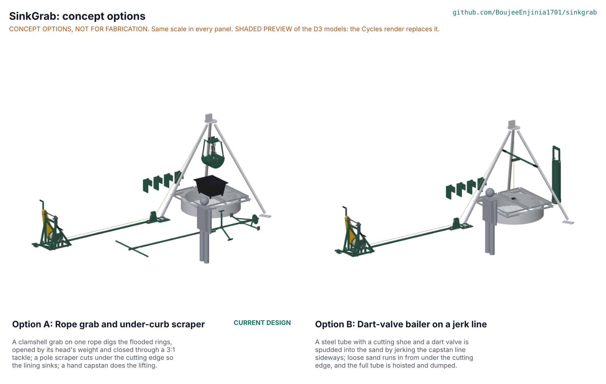

# SinkGrab concept options

**Both options go to Amish without a pick.** Option A, the rope grab and under-curb scraper SinkGrab has carried since TRL 3, scores 167 against 153 for option B, a dart-valve bailer spudded on a jerk line: 8.4 % apart, inside the 10 % band in which STANDARDS section 21 sends both options to Amish. Option A is the only one that can cut under the ring's edge, correct tilt from the surface and dig laterite and clay; option B is simpler, lighter and cheaper but works only where loose sand runs in. Until Amish decides, the repo keeps option A as its design (it is what the drawings, BOM and build plan describe) and the choice is recorded as proposed, awaiting Amish in SKG-DEC-001 (O1) and argued in SKG-DDR-005. Method: STANDARDS section 21.

*Figure 1. Options A and B from the detailed kit 1.9 models, each at the well head with the HatchSide tripod in grey and a 1.75 m person for scale. Until the Cycles render is made on the studio machine, `media/options.png` is a shaded preview of the same models (`cad/src/options_preview.py`). Concept options, not for fabrication.*

## The options

### Option A: rope grab and under-curb scraper (the current design)

A two-shell clamshell grab on one 8 mm line digs the flooded rings: it is lowered closed, opens under its head's weight when the line is slacked on the bottom, and is closed and lifted by the same line through a 3:1 tackle. An under-curb scraper on 2 m pole sections reaches under the bottom ring; the pole's weight opens two arms whose toe blades cut 40 mm past the ring's outer face, and two people turn it with a T-bar through the closed well-head doors, so the rings sink through loosened soil. Scraping only the high side, with ballast saddles hung on it, corrects tilt. A hand capstan with a 4:1 chain drive, ratchet, weighted band brake and a crank shear pin does the lifting through a lead sheave under the HatchSide tripod's leg A foot; a calibrated shear link keeps the line inside the tripod's 150 kg rating. The detailed model has 519 parts (170 fasteners, 103 weld beads). Key risks: skin friction on the rings (STEM S21, failing on paper), the overload window (S6, S7), the bite in denser soil (S2), the cycle time (PR-004, about 0.2 min over). From a co-design partner it needs a trial well and a crew to time it.

### Option B: dart-valve bailer on a jerk line

A steel tube 219 mm across and 1.1 m long, with a bevelled cutting shoe and a dart valve, hangs on the same capstan line. With the drum held on its pawl, two people spud it: a jerk bar with a grooved roller hooks the vertical line about 1 m above the closed doors and pulls it 0.5 m sideways, which lifts the bailer about 0.24 m, and lets it go so the bailer drops back. Each drop drives the shoe into the loose sand, the sand pushes the dart up and enters, and on the lift the dart closes and holds it. A roller fairlead set over the doors' pole hole guides the line. When full the bailer is hoisted like the grab and set down in the spoil tub, where its dart stem touching the tub floor opens the valve. There is no scraper: the rings sink as loose sand from under the cutting edge runs into the crater the bailer leaves, and tilt is corrected only with saddles. The capstan, cradle, drawbar, well-head frame and saddles are option A's. The detailed model has 369 parts. Key risks: no undercut in clay or laterite (OB6), the jerk effort (OB5), the fill (OB3), shock on the line when the dropped bailer is caught. From a partner it needs a test pit in local sand.

## First-order numbers

Table 1. Options compared (option A from SKG-CAL-001 v0.4; option B from its detailed model and `docs/04-calcs/stem_check.py`, on the same assumptions).

| Quantity | Option A | Option B |
| --- | --- | --- |
| Estimated parts cost (USD) | 3,063 (BOM, with the slip clutch of decision O4) | About 2,720 (indicative, same basis as the BOM: option A less the grab, scraper and two sheaves, plus the bailer, jerk bar and fairlead; the slip clutch included) |
| Mass as modelled at the well head (kg) | 361 (`cad/fidelity.json`) | 318 (`cad/fidelity.json`) |
| Heaviest piece (kg) | 22.4 (capstan frame) | 47.2 (bailer, lifted on the line; carried by two only with its bail and dart removed: barrel, shoe and valve about 36 kg, still over a two-person 33 kg) |
| Soil per cycle | 21.2 L at 75 % fill | 18.1 L at 50 % fill (range 11 to 25 L) |
| Cycle at 10 m, three at the hoist | 3.19 min | About 3.8 min (30 drops of about 2 s in place of opening and closing) |
| Output | 399 L an hour | About 286 L an hour |
| Effort | 55 N each on the cranks; 142 N each on the T-bar | 55 N each on the cranks; 180 to 260 N each on the jerk bar, about 30 pulls a run |
| Line limit | Working pull 1,058 N; slip clutch margin 1.06 on the steady pull, third rope layer (decision O4) | Working pull 1,096 N; slip clutch margin 1.02 |
| Undercut and tilt correction | Scraper under the cutting edge; scrape the high side; saddles | None; saddles only |
| Soils | Silt, sand, laterite, clayey sand (to confirm, PR-013) | Loose sand and gravel only |
| Parts count (detailed model) | 519 | 369 |
| STEM check (after the independent review) | S21, S6, S7, E2, B4 fail with a fix proposed; S2, S3, S8, S10a, S14a, S22 to confirm by trial | OB6 (as S21), OB5 fail with a fix proposed; OB3 to confirm by trial; shares S6, S7 and E2 through the capstan and link |

## Scoring

Table 2. Weighted scoring (weights: High UR 3, Medium 2, Low 1; added criteria as the template weights them; scores 1 to 5).

| Criterion | Source | Weight | A | B | Reason |
| --- | --- | --- | --- | --- | --- |
| Dig below the water table | UR-001 | 3 | 3 | 2 | A undercuts, but on paper neither option sinks the rings without help (S21, OB6, both failing after the independent review); B also fails in cohesive soil. The review changed no score |
| Nobody in the well | UR-002 | 3 | 5 | 5 | Both work entirely from the surface |
| Keep the lining straight | UR-003 | 3 | 4 | 2 | A scrapes the high side and hangs saddles; B has saddles only |
| Fits the wells | UR-004 | 3 | 4 | 5 | A needs a longer arm pair for 1.2 to 1.3 m rings; B's 232 mm shoe fits any ring |
| Enough soil a day | UR-005 | 3 | 4 | 3 | 399 against about 286 L an hour |
| Effort a crew can keep up | UR-006 | 3 | 4 | 3 | A 55 N cranks, 142 N T-bar; B adds 180 to 260 N jerk pulls |
| Lifting gear we can trust | UR-007 | 3 | 4 | 3 | Link margin 1.14 against 1.10; B shock-loads the line on every drop |
| Portable | UR-008 | 2 | 3 | 4 | 361 against 318 kg modelled; B's bailer is one 47 kg piece but moves on the line |
| Built and mended locally | UR-009 | 3 | 3 | 4 | A needs plate rolls, a linkage and many pins; B is pipe and plate |
| Affordable | UR-010 | 2 | 4 | 4 | Both well inside the target |
| Works in our soils | UR-011 | 2 | 4 | 1 | B cannot make progress in clay or laterite |
| Safe air at the well | UR-012 | 3 | 5 | 5 | Same detectors and stops |
| A method we can specify | UR-013 | 2 | 4 | 4 | Both have clear stop rules; B's crew stands closer to the moving line |
| Cost against the value-engineering target | | 2 | 4 | 5 | USD 3,063 against about 2,720 of 4,000 (scored before decision O4, which adds about the same to both) |
| Buildable with local skills and tools | | 2 | 3 | 4 | As UR-009 |
| Safety | | 3 | 4 | 3 | B's jerk crew works beside the loaded line at the well mouth |
| Maintenance | | 1 | 3 | 4 | A has more pins, sheaves and link pins to keep |
| **Weighted total** | | | **167** | **153** | B is 8.4 % below A |

## Recommendation

The scores are within 10 %, so both options go to Amish without a pick (STANDARDS section 21), as SKG-DEC-001 O1 and SKG-DDR-005. The case for each:

- **Option A** is the only one of the two that does all of UR-001, UR-003 and UR-011: it cuts under the ring, steers the lining and digs cohesive soils. It is the design already drawn, priced and planned.
- **Option B** is simpler to build and mend, about USD 330 cheaper, about 40 kg lighter as modelled, and has no linkage under water. In clean running sand, where a clamshell fills poorly, it may lift more per cycle than its first-order 18 L.

**The runner-up's best idea to graft onto option A:** carry a bailer as an accessory on the same line for layers of clean running sand, where the grab's fill is low and the sand runs in from under the edge by itself; it needs no other change to option A. B's centred line entry would also remove A's 8 to 9 degree hang out of level in air (STEM S24), which matters little because the grab settles level once the line is slack.
